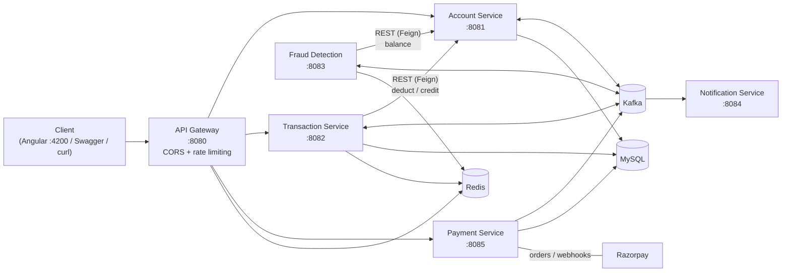
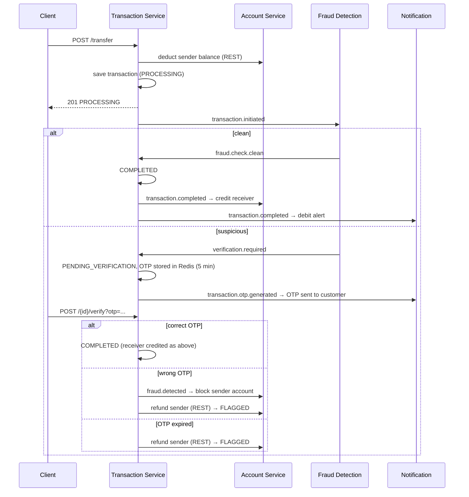

# Bank Backend API

A microservices banking backend built with **Spring Boot 4**, **Spring Cloud Gateway**, **Apache Kafka**, **Redis** and **MySQL**.

It provides account management, money transfers between accounts (with real-time fraud detection and OTP verification), Razorpay card payments, and event-driven customer notifications. Transfers are coordinated with the **Saga pattern**: every step publishes an event, and failed or suspicious transfers are rolled back automatically by refunding the sender.

---

## Table of Contents

- [Architecture](#architecture)
- [Services](#services)
- [Tech Stack](#tech-stack)
- [Prerequisites](#prerequisites)
- [Getting Started](#getting-started)
- [API Documentation (Swagger)](#api-documentation-swagger)
- [API Reference](#api-reference)
- [Error Responses](#error-responses)
- [How a Transfer Works (Saga)](#how-a-transfer-works-saga)
- [Fraud Detection Rules](#fraud-detection-rules)
- [Kafka Topics](#kafka-topics)
- [Configuration](#configuration)
- [Testing the System End-to-End](#testing-the-system-end-to-end)
- [Troubleshooting](#troubleshooting)
- [Project Structure](#project-structure)
- [Known Limitations](#known-limitations)

---

## Architecture



- **Synchronous calls (REST/Feign)** are used where an answer is needed immediately, for example deducting the sender's balance before a transfer starts.
- **Asynchronous events (Kafka)** connect everything else: fraud checks, completion, refunds, account blocking and notifications.
- **Clients only talk to the API Gateway (`:8080`).** The gateway routes requests, applies CORS for the frontend, and rate-limits each client IP using Redis.

---

## Services

| Service | Port | Responsibility | Storage |
|---|---|---|---|
| **api-gateway** | 8080 | Single entry point, routing, CORS, Redis rate limiting, combined Swagger UI | Redis |
| **account-service** | 8081 | Create/look up accounts, balances, block accounts, debit/credit for transfers | MySQL `account_service` |
| **transaction-service** | 8082 | Transfers (Saga orchestrator), transaction history, OTP verification | MySQL `transaction_service`, Redis (OTP) |
| **fraud-detection-service** | 8083 | Checks every new transfer for suspicious activity (Kafka only, no REST API) | Redis |
| **notification-service** | 8084 | Sends customer alerts for OTPs, debits, refunds, fraud and payments (Kafka only, no REST API) | — |
| **payment-service** | 8085 | Razorpay payment orders and webhooks | MySQL `payment_service` |

The databases are created automatically on first start (`createDatabaseIfNotExist=true`), and tables are created and updated by Hibernate (`ddl-auto: update`).

---

## Tech Stack

| Area | Technology |
|---|---|
| Language | Java 17 |
| Framework | Spring Boot 4.1, Spring Cloud 2025.1 (Gateway, OpenFeign) |
| Messaging | Apache Kafka (Confluent 7.4, with Zookeeper) |
| Databases | MySQL 8.0, Redis |
| Payments | Razorpay Java SDK |
| API docs | springdoc-openapi 3.1 (OpenAPI 3 / Swagger UI) |
| Build | Maven (each service includes the Maven Wrapper `mvnw`) |
| Local infrastructure | Docker Compose |

---

## Prerequisites

| Tool | Version | Check |
|---|---|---|
| JDK | 17+ | `java -version` |
| Docker Desktop | Recent, and running | `docker ps` |
| Git | Any | `git --version` |
| Maven | Optional, each service ships `mvnw` | `mvn -v` |

These ports must be free on your machine: **8080–8085** (services), **3307** (MySQL), **6379** (Redis), **9092** (Kafka).

---

## Getting Started

### 1. Clone the repository

```bash
git clone https://github.com/chunkityip/bank.git
cd bank
```

### 2. Start the infrastructure

```bash
docker compose up -d
```

This starts **MySQL** (host port `3307`, user `root`, password `root`), **Redis** (`6379`), **Zookeeper** and **Kafka** (`9092`). Check that all four containers are up:

```bash
docker ps
```

> MySQL is published on host port **3307**, not 3306, so it won't conflict with a MySQL server already installed on your machine.

### 3. Start the services

Open one terminal per service and run the following from the repository root. On Windows, use `mvnw.cmd` instead of `./mvnw`.

```bash
cd account-service         && ./mvnw spring-boot:run
cd transaction-service     && ./mvnw spring-boot:run
cd fraud-detection-service && ./mvnw spring-boot:run
cd notification-service    && ./mvnw spring-boot:run
cd payment-service         && ./mvnw spring-boot:run
cd api-gateway             && ./mvnw spring-boot:run
```

Start **account-service first**, because other services call it. Start the **api-gateway last**.

You can also run each `*Application` class from IntelliJ IDEA: open the repository root and import each folder as a Maven project.

### 4. Verify

Each service exposes a health endpoint:

```bash
curl http://localhost:8081/actuator/health   # {"status":"UP"}
```

Then open the Swagger UI at **http://localhost:8080/swagger-ui.html**.

### 5. Stop everything

Stop the services with `Ctrl+C`, then run:

```bash
docker compose stop      # keep the data
docker compose down -v   # or: remove containers AND the MySQL data volume
```

---

## API Documentation (Swagger)

Interactive API docs are generated automatically from the code with springdoc-openapi.

### Combined Swagger UI (recommended)

**http://localhost:8080/swagger-ui.html**

Pick a service from the **"Select a definition"** dropdown in the top-right corner. Requests sent with **"Try it out"** go **through the API Gateway**, so they use the same routing and rate limiting as the real frontend.

### Swagger UI for each service

| Service | Swagger UI | OpenAPI JSON |
|---|---|---|
| Account Service | http://localhost:8081/swagger-ui.html | http://localhost:8081/v3/api-docs |
| Transaction Service | http://localhost:8082/swagger-ui.html | http://localhost:8082/v3/api-docs |
| Payment Service | http://localhost:8085/swagger-ui.html | http://localhost:8085/v3/api-docs |

On these pages, "Try it out" calls the service **directly** and bypasses the gateway. This is useful for debugging a single service.

> Fraud Detection and Notification services have no REST endpoints, so they have no Swagger page. They react only to Kafka events.

### Importing into Postman

In Postman, choose **Import → Link** and paste one of the OpenAPI JSON URLs above, for example `http://localhost:8080/account-service/v3/api-docs`.

---

## API Reference

All paths are relative to the gateway: `http://localhost:8080`.

### Account Service: `/api/v1/accounts`

| Method | Path | Description |
|---|---|---|
| `POST` | `/api/v1/accounts` | Create an account → `201` |
| `GET` | `/api/v1/accounts/{accountNumber}` | Get account details |
| `GET` | `/api/v1/accounts/{accountNumber}/balance` | Get the current balance |
| `PUT` | `/api/v1/accounts/{accountNumber}/block` | Block an account |
| `PUT` | `/api/v1/accounts/{accountNumber}/deduct?amount=` | Debit the account *(internal, used by Transaction Service)* |
| `PUT` | `/api/v1/accounts/{accountNumber}/credit?amount=` | Credit the account *(internal, used by Transaction Service)* |

Example create request:

```json
{
  "accountHolderName": "Alice",
  "email": "alice@example.com",
  "phone": "5550001",
  "accountType": "SAVINGS",
  "initialDeposit": 1000
}
```

- `accountType` is one of `SAVINGS`, `CURRENT`, `FIXED_DEPOSIT`.
- A unique 12-digit `accountNumber` is generated automatically.
- New accounts start as `ACTIVE`.

### Transaction Service: `/api/v1/transactions`

| Method | Path | Description |
|---|---|---|
| `POST` | `/api/v1/transactions/transfer` | Start a transfer → `201`, status `PROCESSING` |
| `GET` | `/api/v1/transactions/{transactionId}` | Get a transaction and its current status |
| `GET` | `/api/v1/transactions/account/{accountNumber}` | Transaction history for an account (sent and received) |
| `POST` | `/api/v1/transactions/{transactionId}/verify?otp=` | Submit the OTP for a transfer flagged as suspicious |

Example transfer request:

```json
{
  "senderAccountNumber": "805589811777",
  "receiverAccountNumber": "028328257794",
  "amount": 100,
  "description": "Rent"
}
```

Transaction statuses are `PROCESSING`, `PENDING_VERIFICATION`, `COMPLETED` and `FLAGGED` (cancelled and refunded). See [How a Transfer Works](#how-a-transfer-works-saga).

### Payment Service: `/api/v1/payments`

| Method | Path | Description |
|---|---|---|
| `POST` | `/api/v1/payments/create-order` | Create a Razorpay order → `201` (returns `razorpayOrderId` and `keyId` for the checkout widget) |
| `POST` | `/api/v1/payments/webhook` | Razorpay webhook receiver (`payment.captured`, `payment.failed`) |

```json
{ "accountNumber": "805589811777", "amount": 500, "description": "Top-up" }
```

### Rate limits (per client IP, at the gateway)

| Route | Sustained | Burst |
|---|---|---|
| `/api/v1/accounts/**` | 10 req/s | 20 |
| `/api/v1/transactions/**` | 10 req/s | 20 |
| `/api/v1/payments/**` | 5 req/s | 10 |

When a client goes over the limit, the gateway responds with `429 Too Many Requests`.

### CORS

The gateway allows browser requests from `http://localhost:4200` (the Angular dev server). CORS is configured **only in the gateway**. Do not add CORS configuration to individual services: the browser would receive duplicate `Access-Control-Allow-Origin` headers and reject the response. To allow another frontend origin, edit `globalcors` in `api-gateway/src/main/resources/application.yaml`.

---

## Error Responses

All services return errors in the standard [RFC 7807 Problem Details](https://www.rfc-editor.org/rfc/rfc7807) JSON format:

```json
{
  "status": 404,
  "title": "Not Found",
  "detail": "Account not found: 000000000000",
  "instance": "/api/v1/accounts/000000000000"
}
```

| Status | When |
|---|---|
| `400` | Validation failed. An `errors` object lists each invalid field: `{"email": "Invalid email format", ...}` |
| `404` | Account or transaction not found |
| `409` | Email already registered |
| `422` | Business rule violated: insufficient funds, or the account is not active |
| `429` | Rate limit exceeded (gateway) |
| `502` | A downstream dependency failed (Account Service unreachable, Razorpay error) |
| `500` | Unexpected error. Details are logged on the server and not returned to the client |

If Account Service rejects a step of a transfer, its error (for example `422 Insufficient funds`) is passed through unchanged in the response from `/transactions/transfer`.

**Frontend tip:** branch on `error.status`, show `error.error.detail` to the user, and use `error.error.errors` for messages on individual form fields.

---

## How a Transfer Works (Saga)



1. The sender's balance is deducted **immediately and synchronously**. If the deduction fails (insufficient funds, unknown or blocked account), the transfer is rejected right away.
2. The fraud check runs **asynchronously**, so the transfer returns `PROCESSING`. Clients should poll `GET /api/v1/transactions/{id}` to follow the status.
3. A cancelled transfer is **compensated**: the sender is refunded and the transaction is marked `FLAGGED`, with the reason in `failureReason`.

---

## Fraud Detection Rules

`fraud-detection-service` checks every new transfer. If **any** rule matches, the transfer needs OTP verification. Thresholds are configured in `fraud-detection-service/src/main/resources/application.yaml`:

| Rule | Triggers when | Config key (default) |
|---|---|---|
| Velocity | More than N transfers from the same account within 60 seconds | `fraud.max-transactions-per-minute` (5) |
| Unusual amount | Amount is greater than N × the account's running average transfer amount | `fraud.suspicious-amount-multiplier` (5) |
| Balance drain | Amount is greater than X% of the sender's balance | `fraud.max-balance-percentage` (0.90) |

The counters and averages are kept in Redis under `fraud:velocity*` and `fraud:avgAmount:*`.

---

## Kafka Topics

| Topic | Producer | Consumers | Purpose |
|---|---|---|---|
| `transaction.initiated` | Transaction | Fraud Detection | New transfer to check |
| `fraud.check.clean` | Fraud Detection | Transaction | Transfer passed all checks |
| `verification.required` | Fraud Detection | Transaction | Transfer is suspicious, an OTP is needed |
| `transaction.otp.generated` | Transaction | Notification | Send the OTP to the customer |
| `transaction.completed` | Transaction | Account, Notification | Credit the receiver, send a debit alert |
| `transaction.refunded` | Transaction | Notification | Refund alert |
| `fraud.detected` | Transaction | Account, Notification | Block the account, send a fraud alert |
| `payment.completed` | Payment | Notification | Payment success alert |
| `payment.failed` | Payment | Notification | Payment failure alert |

Topics are created automatically on first use (`KAFKA_AUTO_CREATE_TOPICS_ENABLE=true`). Messages are JSON. Consumers read every message as a plain `Map`, so services don't share any Java event classes.

---

## Configuration

Each service is configured in `src/main/resources/application.yaml`. These values can be overridden with environment variables:

| Variable | Used by | Default |
|---|---|---|
| `DB_USERNAME` | account, transaction, payment | `root` |
| `DB_PASSWORD` | account, transaction, payment | `root` |
| `REDIS_HOST` / `REDIS_PORT` | gateway, transaction, fraud | `localhost` / `6379` |
| `REDIS_PASSWORD` | fraud | *(empty)* |
| `MAIL_HOST` / `MAIL_PORT` | notification, payment | `smtp.gmail.com` / `587` |
| `MAIL_USERNAME` / `MAIL_PASSWORD` | notification, payment | *(empty)* |
| `RAZORPAY_KEYID` / `RAZORPAY_KEYSECRET` | payment | `rzp_xxxxxx` / *(empty)* |

You can also override any property on the command line:

```bash
./mvnw spring-boot:run -Dspring-boot.run.arguments="--razorpay.key-id=rzp_test_123 --razorpay.key-secret=abc"
```

### Using your own MySQL instead of Docker

Point the services at your server and supply its credentials, for example:

```bash
DB_PASSWORD=yourpassword ./mvnw spring-boot:run -Dspring-boot.run.arguments="--spring.datasource.url=jdbc:mysql://localhost:3306/account_service?createDatabaseIfNotExist=true&useSSL=false&allowPublicKeyRetrieval=true&serverTimezone=UTC"
```

### Razorpay

`POST /payments/create-order` calls Razorpay, so it needs real **test-mode keys** from the [Razorpay dashboard](https://dashboard.razorpay.com/app/keys). With the placeholder keys, the endpoint returns `502`.

For webhooks, Razorpay needs a public URL. In local development, expose the gateway with a tunnel such as `ngrok http 8080`, then register `https://<your-tunnel>/api/v1/payments/webhook` in the Razorpay dashboard.

---

## Testing the System End-to-End

You can run this whole flow in the Swagger UI, or with curl as shown here:

```bash
GW=http://localhost:8080/api/v1

# 1. Create two accounts. Note the "accountNumber" in each response.
curl -X POST $GW/accounts -H "Content-Type: application/json" \
  -d '{"accountHolderName":"Alice","email":"alice@test.com","phone":"5550001","accountType":"SAVINGS","initialDeposit":1000}'
curl -X POST $GW/accounts -H "Content-Type: application/json" \
  -d '{"accountHolderName":"Bob","email":"bob@test.com","phone":"5550002","accountType":"SAVINGS","initialDeposit":500}'

# 2. Transfer 100 from Alice to Bob. The response returns status PROCESSING.
curl -X POST $GW/transactions/transfer -H "Content-Type: application/json" \
  -d '{"senderAccountNumber":"<ALICE>","receiverAccountNumber":"<BOB>","amount":100}'

# 3. A second or two later: the status is COMPLETED and the balances are 900 / 600
curl $GW/transactions/account/<ALICE>
curl $GW/accounts/<ALICE>/balance
curl $GW/accounts/<BOB>/balance
```

**To test the OTP flow:** transfer more than 90% of the sender's balance. The transfer moves to `PENDING_VERIFICATION`, and the OTP appears in the **notification-service console log**. Submit it with:

```bash
curl -X POST "$GW/transactions/<TRANSACTION_ID>/verify?otp=<OTP>"
```

Submitting a wrong OTP blocks the sender's account and refunds the amount.

### Automated tests

```bash
cd <service> && ./mvnw test
```

The tests start the full Spring context, so run `docker compose up -d` first.

---

## Troubleshooting

| Symptom | Cause / Fix |
|---|---|
| `Ports are not available: ... 3306` (or another port) on `docker compose up` | Something on your machine already uses that port. MySQL is mapped to **3307** for this reason. For other ports, stop the conflicting program or change the host port in `docker-compose.yml`. |
| `Access denied for user 'root'@'localhost'` | The service is connecting to a different MySQL than the Docker one, or with the wrong password. Check that the `mysql` container is running and that `DB_PASSWORD` matches. |
| `Web server failed to start. Port 808x was already in use` | That service is already running, for example from IntelliJ. Stop the other instance. |
| Kafka consumers log connection errors at startup | Kafka needs a few seconds after `docker compose up` before it accepts connections. The services retry on their own. |
| Browser shows a CORS error from Angular | Call the **gateway** (`:8080`), not a service port directly, and check that your origin is listed in the gateway's `globalcors`. |
| Duplicate `Access-Control-Allow-Origin` header | A service still has its own CORS config, or old compiled classes are left in `target/`. Remove the config and run `./mvnw clean`. |
| Changes don't seem to apply, or a deleted class still runs | Old `.class` files are left in `target/`. Run `./mvnw clean` (or *Build → Rebuild Project* in IntelliJ). If clean fails with "Failed to delete target/classes", stop the running app first. OneDrive sync can also lock the folder. |
| `429 Too Many Requests` | You hit the gateway rate limit. Wait a second and retry. |
| `502` on `/payments/create-order` | Razorpay keys are missing or invalid. See [Razorpay](#razorpay). |
| Transfer stays in `PROCESSING` | fraud-detection-service is not running, or Kafka is down. Check its console log. |

---

## Project Structure

```
.
├── docker-compose.yml          # MySQL, Redis, Zookeeper, Kafka
├── api-gateway/                # Spring Cloud Gateway (WebFlux)
│   └── config/                 #   KeyResolver for rate limiting
├── account-service/
├── transaction-service/
├── fraud-detection-service/
├── notification-service/
└── payment-service/
```

Each service is an independent Maven project with the same layout:

```
<service>/src/main/java/com/banking/<service>/
├── controller/     # REST endpoints
├── service/        # Business logic + Kafka consumers (*EventConsumer)
├── repository/     # Spring Data JPA repositories
├── entity/         # JPA entities and enums
├── dto/            # Request/response objects (with validation annotations)
├── client/         # Feign clients for calling other services
├── event/          # Kafka event payloads
├── exception/      # Custom exceptions + GlobalExceptionHandler
└── config/         # OpenAPI and other Spring configuration
```

---

## Known Limitations

These are known gaps to keep in mind when developing against this API:

- **There is no authentication or authorization.** Every endpoint is open. This includes the internal `deduct`, `credit` and `block` endpoints, which are also reachable through the gateway.
- **Notifications are only logged.** `notification-service` writes alerts (including OTPs) to its console. It does not send email or SMS yet.
- **The receiver account is not validated before the sender is debited.** If the receiver doesn't exist, the credit step fails after the transfer completes.
- **A completed Razorpay payment doesn't credit the account.** Payments are recorded and trigger a notification, but no account balance changes.
- **The webhook signature is not verified.** `razorpay.webhook-secret` is defined in the config but not used yet.
